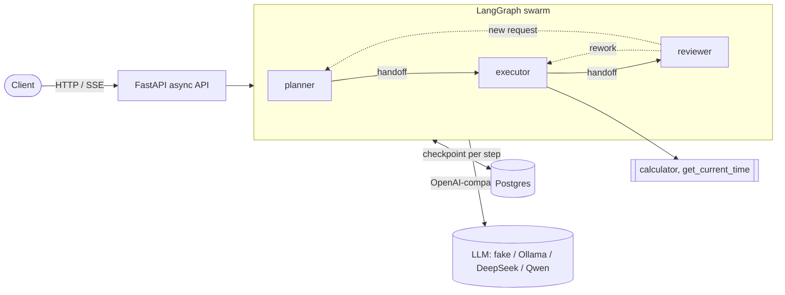

# SwarmOps

[](https://github.com/ltan0136/swarmops/actions/workflows/ci.yml)


**An agent-native swarm on cloud-native infrastructure.** Agents decide *what to do*;
the platform keeps them *running*.

[中文说明](README.zh-CN.md)

- **Agent-native layer:** a [LangGraph](https://github.com/langchain-ai/langgraph) swarm of three
  agents (planner, executor, reviewer) that hand control to each other along explicit edges.
- **Cloud-native layer:** an async FastAPI service, a Postgres checkpointer so every conversation
  survives restarts, containers with health checks, and CI that boots the whole stack.
- **Runs without an API key:** a deterministic offline model drives the full runtime by default.
  Switch to Ollama, DeepSeek, Qwen or OpenAI with two environment variables.

## Architecture



## Quickstart (Docker, no API key)

```bash
cp .env.example .env
docker compose up -d --build --wait
```

Ask the swarm something:

```bash
curl -s -X POST http://localhost:8000/threads/demo/runs \
  -H 'Content-Type: application/json' \
  -d '{"message": "What is (12 + 3) * 4?"}'
```

```json
{
  "thread_id": "demo",
  "answer": "Final answer: 60\n(Checked the executor's calculator result.)",
  "active_agent": "reviewer",
  "steps": [
    {"type": "ai", "name": "planner", "content": "Plan: ...", "tool_calls": ["transfer_to_executor"]},
    {"type": "ai", "name": "executor", "content": "", "tool_calls": ["calculator"]},
    {"type": "tool", "name": "calculator", "content": "60", "tool_calls": []},
    "..."
  ]
}
```

Stream each agent step as Server-Sent Events:

```bash
curl -N -X POST http://localhost:8000/threads/demo/runs/stream \
  -H 'Content-Type: application/json' \
  -d '{"message": "And 2 ** 10?"}'
```

Restart the API and the conversation is still there:

```bash
docker compose restart api && docker compose up -d --wait
curl -s http://localhost:8000/threads/demo
```

Interactive API docs: <http://localhost:8000/docs>. Stop everything with `docker compose down -v`.

## Use a real model

Set these in `.env`, then `docker compose up -d --build --wait` again. Any endpoint that speaks
the OpenAI chat-completions API with tool calling works.

| Provider | `LLM_BASE_URL` | Example `LLM_MODEL` |
|---|---|---|
| Ollama on your machine | `http://host.docker.internal:11434/v1` | `qwen2.5:7b` |
| Ollama in compose (`--profile local-llm`) | `http://ollama:11434/v1` | `qwen2.5:7b` |
| DeepSeek | `https://api.deepseek.com/v1` | `deepseek-chat` |
| Qwen (DashScope, international) | `https://dashscope-intl.aliyuncs.com/compatible-mode/v1` | `qwen-plus` |

```dotenv
LLM_PROVIDER=openai_compatible
LLM_BASE_URL=https://api.deepseek.com/v1
LLM_MODEL=deepseek-chat
LLM_API_KEY=sk-...
```

Model names change over time; check your provider's docs. Pick a model that supports tool
calling, since handoffs between agents are tool calls.

## Local development (no Docker)

```bash
python -m venv .venv && source .venv/bin/activate   # Windows: .venv\Scripts\activate
pip install -e ".[dev]"

swarmops "What is (12 + 3) * 4?"        # one run from the command line
uvicorn swarmops.api.app:app --reload   # or start the API on :8000
pytest -q                                # tests use the offline model and in-memory state
```

Without `DATABASE_URL` the app keeps state in memory. To run the Postgres integration test,
point `SWARMOPS_TEST_DATABASE_URL` at any Postgres (for example the one from `docker compose up postgres`).

## API

| Method | Path | Description |
|---|---|---|
| `GET` | `/healthz` | Liveness, version, LLM provider and checkpointer in use |
| `POST` | `/threads` | Create a new thread id |
| `POST` | `/threads/{thread_id}/runs` | Run the swarm on one message; returns the answer and every step |
| `POST` | `/threads/{thread_id}/runs/stream` | Same, streamed as SSE: `message`*, then `done` or `error` |
| `GET` | `/threads/{thread_id}` | Full message history and the active agent |
| `DELETE` | `/threads/{thread_id}` | Delete every checkpoint of the thread; the id can be reused |

A second run (or a delete) on a thread that is still busy returns `409 Conflict`. A run that exceeds
`RECURSION_LIMIT` steps returns `422`; an upstream LLM failure returns `502`.

## How a run works

1. The swarm routes the message to the thread's `active_agent` (the planner for a new thread).
2. The **planner** writes a short plan and hands off to the **executor**.
3. The **executor** calls tools, then hands off to the **reviewer**.
4. The **reviewer** answers the user, or sends the work back to the executor.
5. Every step is checkpointed to Postgres under the thread id. The reviewer is now active, so the
   next message goes to it first, and it hands new requests back to the planner.

## Project layout

```
swarmops/
├── src/swarmops/
│   ├── api/            # FastAPI app factory, routes, request/response schemas
│   ├── swarm/          # agent graph, prompts and tools
│   ├── llm/            # model factory + offline scripted model
│   ├── checkpoint.py   # Postgres or in-memory checkpointer
│   ├── config.py       # settings from env / .env
│   └── cli.py          # `swarmops "..."` one-shot runner
├── tests/              # unit, API, SSE and Postgres integration tests
├── docs/adr/           # architecture decision records
├── Dockerfile          # multi-stage, non-root, health check
├── docker-compose.yml  # API + Postgres (+ optional Ollama)
└── .github/workflows/  # lint, tests on 3.11-3.13, compose smoke test
```

## Security notes

- `.env` is git-ignored and only `.env.example` (no real keys) is committed. Keep API keys in
  your local `.env`; CI needs no secrets because it uses the offline model.
- Set `SWARMOPS_API_KEY` to require `Authorization: Bearer <key>` on every route except
  `/healthz` (the container health check stays open). It is empty by default, and docker compose
  binds the API and Postgres to `127.0.0.1`; do not expose the API on a network without a key
  and TLS in front of it.

  ```bash
  curl -s -X POST http://localhost:8000/threads/demo/runs \
    -H "Authorization: Bearer $SWARMOPS_API_KEY" -H 'Content-Type: application/json' \
    -d '{"message": "What is 2 ** 8?"}'
  ```
- The Postgres credentials in `.env.example`, compose and CI are local placeholders. Change them
  for any shared environment.
- The calculator parses expressions with `ast` instead of `eval`, so model-generated input cannot
  execute code.

## Design decisions

- [ADR 0001: a swarm with restricted handoff edges](docs/adr/0001-swarm-with-restricted-handoffs.md)
- [ADR 0002: Postgres as the checkpointer](docs/adr/0002-postgres-checkpointer.md)
- [ADR 0003: a scripted offline model for demos, tests and CI](docs/adr/0003-scripted-offline-model.md)

## Roadmap

- [x] **v0.1** Three-agent swarm, async API with SSE, Postgres checkpointer, Docker, CI
- [ ] **v0.2** Tools as separate MCP server containers; human-in-the-loop approval for risky tools
- [ ] **v0.3** Kubernetes (kind + Helm), Redis task queue, KEDA autoscaling, OpenTelemetry + Langfuse
- [ ] **v0.4** Eval suite in CI; experiment runner comparing swarm sizes, topologies and handoff rules,
      including leave-one-agent-out ablations

## License

[MIT](LICENSE)
